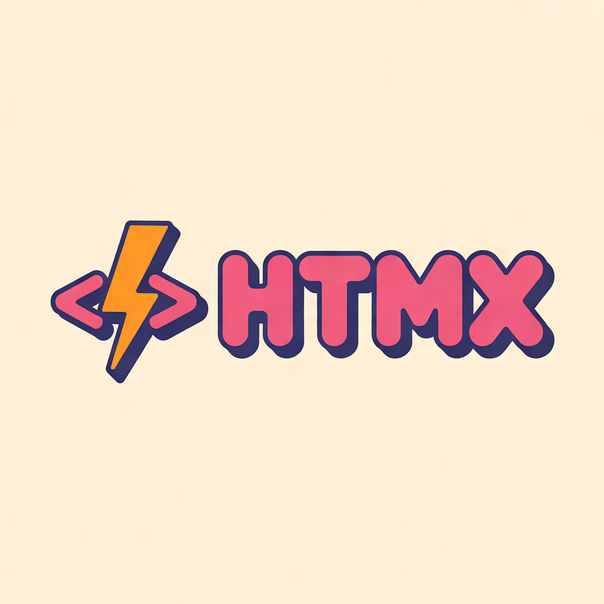
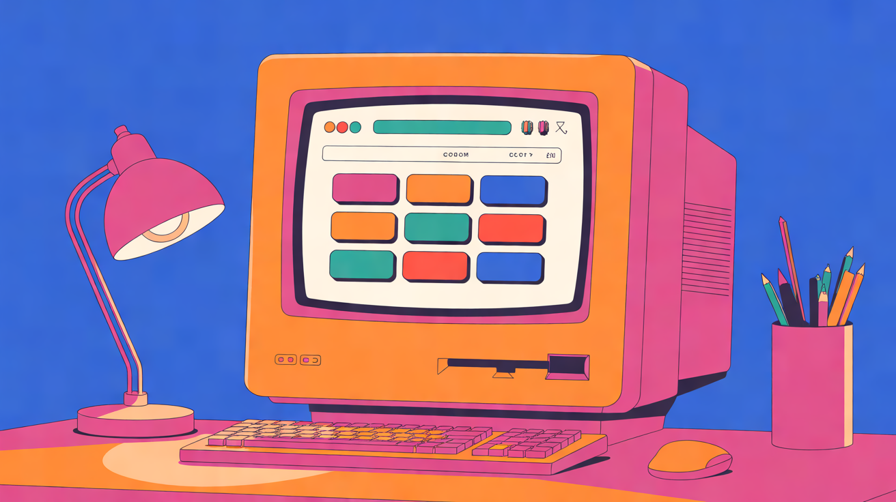
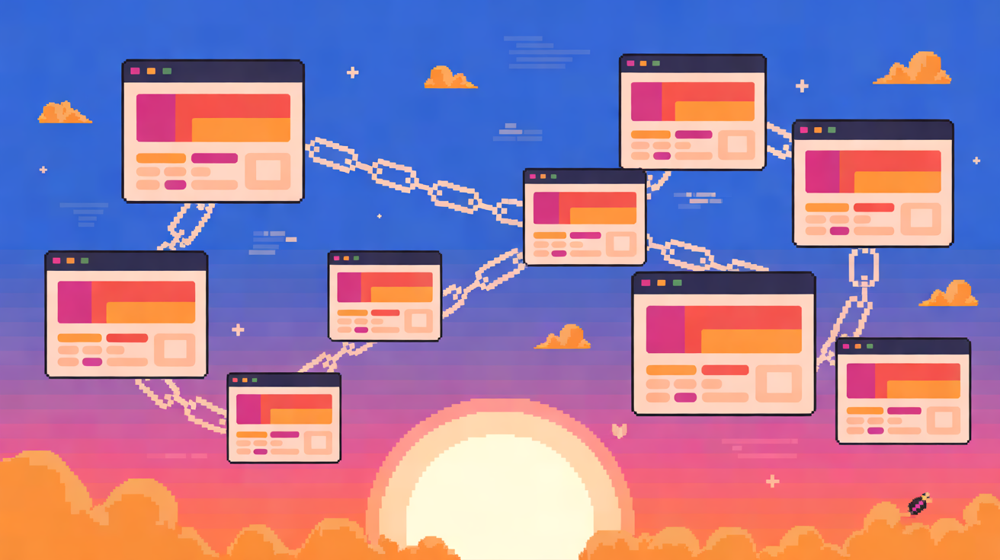

# htmx

htmx is a small, dependency-free JavaScript library that gives plain HTML access to AJAX, CSS transitions, WebSockets and server-sent events. It is for web developers who want to build modern interfaces with hypermedia rather than a heavy front-end framework.

## Logos

Three new concepts, made on Ideogram 3 (`TURBO`, `DESIGN`). The brand name is set in quotes in each prompt.

- Logo 1: a wordmark, "htmx".
- Logo 2: a lettermark, "h", in a rounded badge.
- Logo 3: a symbol of angle brackets joined by a lightning bolt, beside "htmx".

## Palette

| Hex | Role | Source |
|---|---|---|
| #2B5FD9 | primary | chosen |
| #FF8C42 | secondary | chosen |
| #E8457C | accent | chosen |
| #FFF6E0 | background | chosen |
| #1E1B3A | text | chosen |

The page's stylesheet was not readable, and the text shows no hex colors, so all five colors were chosen to fit the playful retro brief.

## Type pairing

- Heading: Righteous (Google Fonts)
- Body: Nunito (Google Fonts)

Righteous has the chunky, retro-web character of the vibe. Nunito is rounded and easy to read at small sizes, so it balances the heading without competing with it.

## Voice

- Confident and direct: it states what htmx does in short, plain sentences, the way the homepage's "high power tools for HTML" does.
- Playful and a little irreverent: the page's haiku, its "uwu" shirts and its Montana note make room for humor without losing the technical point.
- Plain-spoken for developers: it names the real mechanisms (AJAX, WebSockets, SSE) and avoids hype.

## Do and don't

Do:
- Use the blue primary and cream background together for the main layout, with the orange and pink accents sparingly.
- Keep the logos on a plain background and leave clear space around them.
- Set headings in Righteous and body text in Nunito.
- Keep copy short and concrete, with the technical terms spelled out once.

Don't:
- Don't recolor the logos outside this palette.
- Don't put the wordmark in a scene or next to other marks.
- Don't use Righteous for body text or long paragraphs.
- Don't claim a feature htmx does not have, or describe it as a framework.

## Heroes

Headline on hero 1, from the page's own claim: "high power tools for HTML".

## Promo

A 5-second clip made from hero 2: a slow push-in with light drifting across the scene, no text.

## How it was made and what it cost

- Logos 1–3: `fal-ai/ideogram/v3`, `TURBO`, `DESIGN`, `square_hd`, one image each. $0.03 each, $0.09 total.
  - Logo 1 prompt: "A flat logo mark on a plain solid cream background, centered, no scene, no people, no extra objects. The name \"htmx\" set in a chunky retro rounded typeface, bold and playful. The name in double quotes is the only text."
  - Logo 2 prompt: "A flat logo mark on a plain solid cream background, centered, no scene, no people, no extra objects. A simple bold rounded geometric badge holding the lettermark \"h\" in a chunky retro style. The letter in double quotes is the only text."
  - Logo 3 prompt: "A flat logo mark on a plain solid cream background, centered, no scene, no people, no extra objects. A simple symbol of angle brackets joined by a lightning bolt, beside the name \"htmx\" in a chunky retro rounded typeface. The name in double quotes is the only text."
- Hero 1: `fal-ai/ideogram/v3`, `TURBO`, `DESIGN`, `landscape_16_9`. $0.03. Prompt: "A bold retro web poster on a cream background with blue and orange shapes. A chunky headline \"high power tools for HTML\" set in large playful letters. One visual idea: a glowing hypertext arrow linking two HTML tag brackets. Flat graphic style, clean layout."
- Hero 2: `fal-ai/ideogram/v3`, `TURBO`, `GENERAL`, `landscape_16_9`, negative prompt `text, letters, words, logo, watermark`. $0.03. Prompt: "Wide scene of a retro desk with a vintage CRT monitor showing a simple web page of colorful buttons, soft warm light, flat illustration style, no people visible."
- Hero 3: `fal-ai/ideogram/v3`, `TURBO`, `GENERAL`, `landscape_16_9`, negative prompt `text, letters, words, logo, watermark`. $0.03. Prompt: "Wide scene of a retro pixel-art network of glowing hyperlinks joining floating browser windows across a blue sky at sunset, warm light, flat illustration style, no people."
- Promo: `fal-ai/kling-video/v2.5-turbo/pro/image-to-video` from hero 2, 5 seconds at $0.07 a second. $0.35. Prompt: "A slow push-in toward the glowing center of the scene; warm light gradually drifts across the surfaces from left to right; a gentle, steady drift of the camera. Motion of camera and light only." Negative prompt: `blur, distort, low quality, text, letters`.

Total fal cost: $0.53, against a plan price of $0.53 and a cap of $1.50.

## Notes on the run

- The first six submissions used keys of the form `bk-htmx.org-20261120-<name>`. fal answered each with a 409 conflict, meaning the key was bound to another request. Nothing was billed for those. The logo-1 key was tied to an earlier Recraft job, which this kit did not use. All six were resubmitted under `bk-htmx.org-20261120r2-<name>` keys, and those are the images in this kit.
- Logo 1 through hero 3 were saved under their media paths by an earlier script step, which also reported an error at its end. The save refusals since then show each file is in place.
