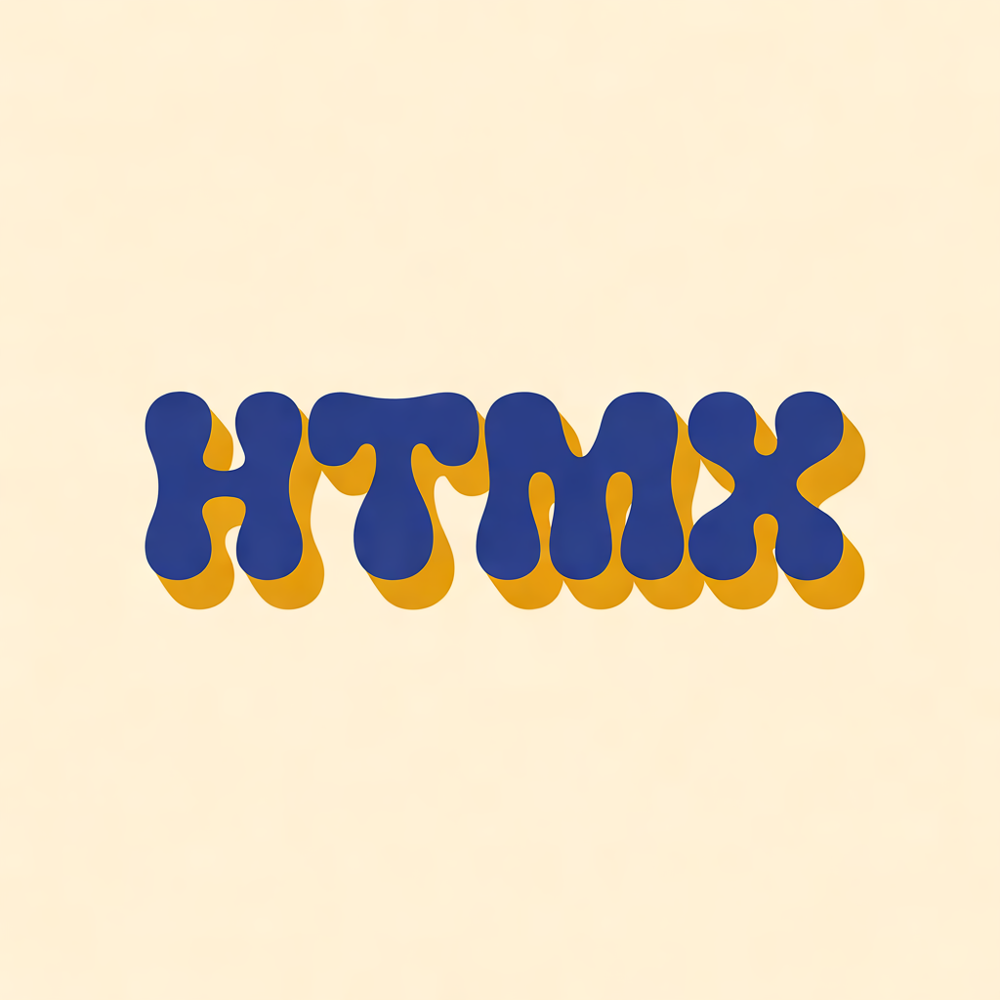
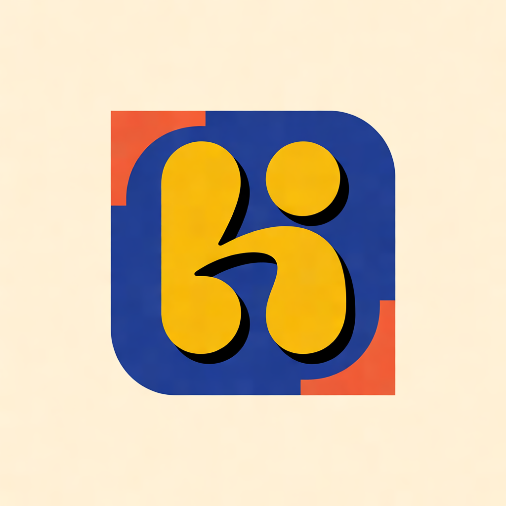
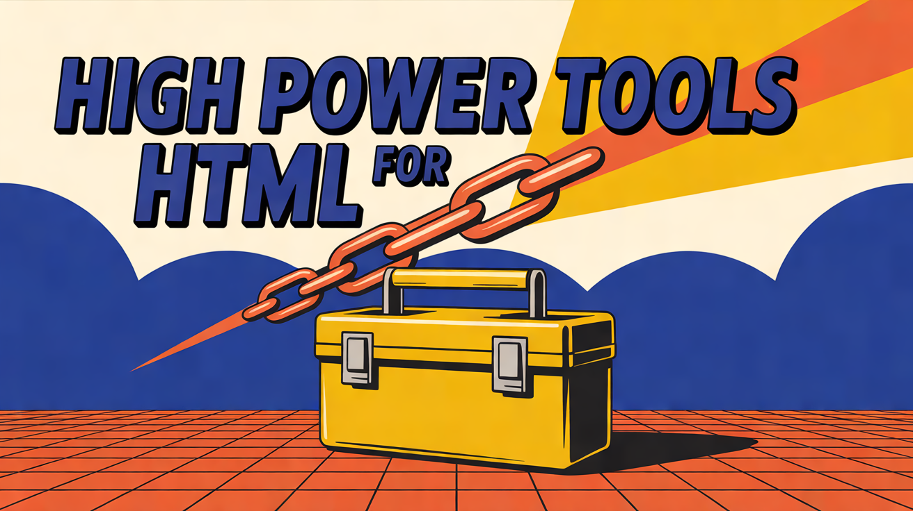

# htmx

htmx gives HTML direct access to AJAX, CSS transitions, WebSockets and server-sent events through attributes. It serves developers who want to build modern interfaces with hypertext, without a heavy JavaScript framework.

Source: https://htmx.org/ (page read 2026-11-20). Vibe requested: playful, retro web.

## Logos

Three new concepts, made on Ideogram 3: a wordmark, a lettermark, and a symbol beside the name.

## Palette

| Hex | Role | Source |
|---|---|---|
| #1F3A93 | primary | chosen |
| #F2B705 | secondary | chosen |
| #E4572E | accent | chosen |
| #FFF6E0 | background | chosen |
| #1A1A1A | text | chosen |

The page's text view showed no color values, so all five colors were chosen to fit the playful, retro tone. Background and text are high contrast.

## Type pairing

- Heading: **Bungee**
- Body: **Space Mono**

Why: Bungee's chunky display letters carry the retro, playful register; Space Mono's monospace body suits a web-tool brand that talks about HTML.

## Voice

- Plainspoken and confident: it states what the tool does without hype.
- Playful with the reader: it jokes lightly and invites tinkering.
- Technical but warm: it explains hypertext simply and treats the developer as a peer.

## Do and don't

Do:
- Use the primary blue for headings and the cream background for large areas.
- Use the orange-red accent sparingly, for links and highlights.
- Keep the wordmark on a plain cream or white background with clear space around it.
- Set headlines in Bungee and body text in Space Mono.

Don't:
- Don't stretch, rotate or recolor the logos outside this palette.
- Don't put the wordmark over busy photos or other logos.
- Don't use more than two accent colors on one screen.
- Don't use Space Mono for long body copy.

## Heroes

- Hero 1 carries the headline "high power tools for HTML", taken from the page title.
- Heroes 2 and 3 are text-free scenes.

## Promo

A 5-second clip animated from Hero 2: a slow push-in with light drifting across the scene.

## How the images and clip were made

All prompts were built from the palette and the brand's own name. Ideogram 3 was used at TURBO speed, without prompt expansion.

- **logo-1** (`fal-ai/ideogram/v3`, DESIGN): "A flat logo mark on a plain solid cream background, centered, no scene, no people, no extra objects. The wordmark "htmx" set in a chunky retro rounded display typeface, deep blue letters with a mustard drop shadow. The name in double quotes is the only text."
- **logo-2** (`fal-ai/ideogram/v3`, DESIGN): "A flat logo mark on a plain solid cream background, centered, no scene, no people, no extra objects. A lettermark: the letter "h" in a bold retro monoline style inside a simple deep blue rounded square, with an orange-red angle bracket accent. The letter in double quotes is the only text."
- **logo-3** (`fal-ai/ideogram/v3`, DESIGN): "A flat logo mark on a plain solid cream background, centered, no scene, no people, no extra objects. A simple symbol of a lightning bolt crossed with an angle bracket in orange-red, placed beside the name "htmx" in deep blue chunky retro lettering. The name in double quotes is the only text."
- **hero-1** (`fal-ai/ideogram/v3`, DESIGN): "A retro web-era poster scene: a glowing orange-red hypertext link arcs across a cream sky above a chunky mustard toolbox. The headline "high power tools for HTML" set in bold blue retro display letters across the top third, with empty space for it."
- **hero-2** (`fal-ai/ideogram/v3`, GENERAL, negative prompt "text, letters, words, logo, watermark"): "A retro 1990s computer desk seen from a distance, a beige CRT monitor glowing with a web page, orange-red light lines flowing from its screen across the desk toward a row of chunky mustard tool handles. Warm cream and deep blue palette, soft light moving across the scene, flat illustration style."
- **hero-3** (`fal-ai/ideogram/v3`, GENERAL, negative prompt "text, letters, words, logo, watermark"): "A retro workshop bench in a sunlit room, a neat row of vintage hand tools and a small beige desktop computer, with a tangle of orange-red light threads being tied neatly into a tidy knot. Cream walls, deep blue shadows, mustard accents, flat illustration style, no people."
- **promo** (`fal-ai/kling-video/v2.5-turbo/pro/image-to-video`, 5 s, from hero-2): "A slow push-in toward the glowing monitor; soft light drifts gently across the cream and deep blue scene, orange-red light lines pulse slowly, camera holds steady with a gentle drift." Negative prompt: "blur, distort, low quality, text, letters".

## fal cost

| Step | Endpoint | Units | Unit price | Cost |
|---|---|---|---|---|
| Logos | fal-ai/ideogram/v3 | 3 images | $0.03 | $0.09 |
| Heroes | fal-ai/ideogram/v3 | 3 images | $0.03 | $0.09 |
| Promo | fal-ai/kling-video/v2.5-turbo/pro/image-to-video | 5 s | $0.07 | $0.35 |
| **Total** | | | | **$0.53** |

Budget cap: $1.00. Plan price: $0.53. Nothing failed, and every file was saved.
